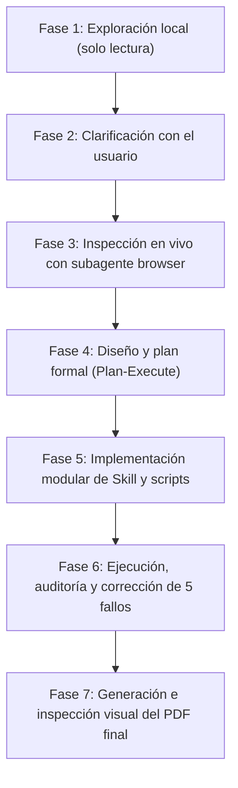
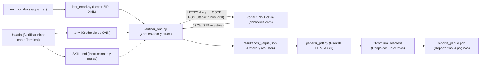
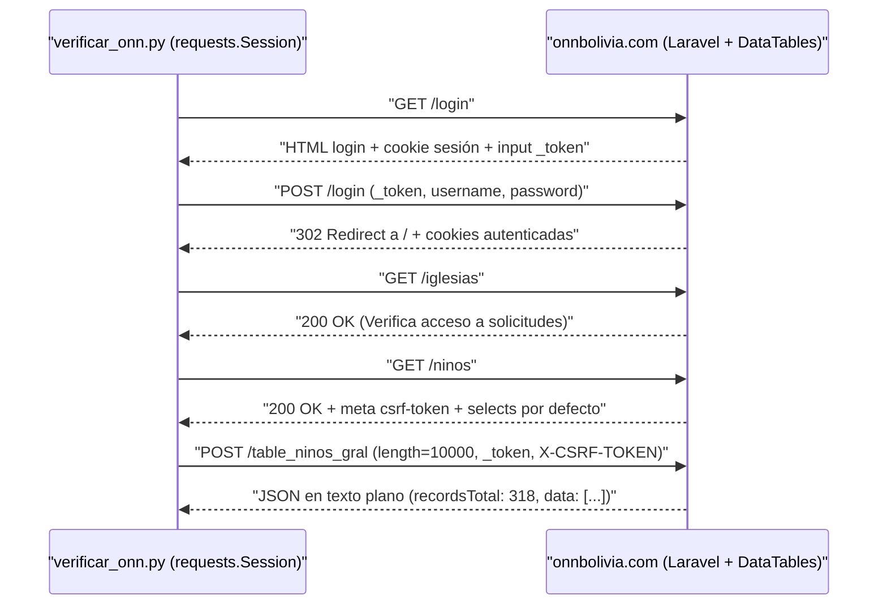
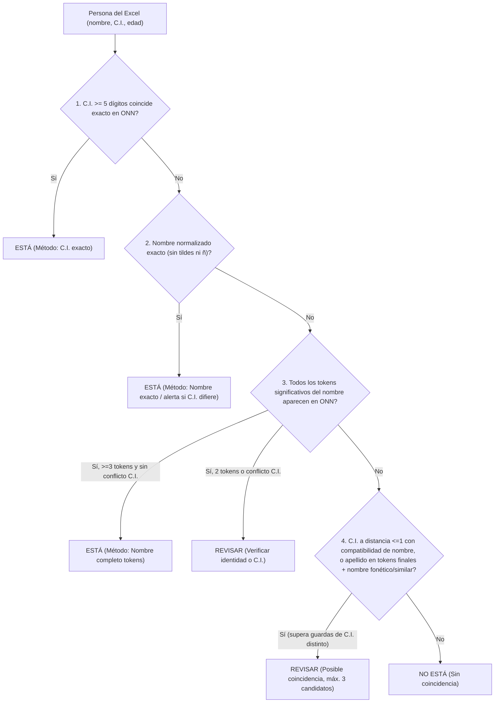

# Informe Técnico y Educativo: Cómo se Construyó el Flujo de Verificación en ONN Bolivia

Este documento explica paso a paso **qué se hizo**, **por qué se tomó cada decisión**, **qué conceptos técnicos intervienen**, **cómo fluyen los datos** (con diagramas) y **qué prompts reales se usaron** para transformar una lista de instrucciones manuales en un flujo reutilizable y automatizado.

---

## 1. Visión general del problema y la solución

El objetivo original era automatizar 7 pasos operativos: entrar a `https://onnbolivia.com/login`, autenticarse, abrir **Solicitudes de iglesias → Lista de niños**, buscar cada persona de [yaque.xlsx](file:///home/jesulim/Work/workflow/yaque.xlsx) por nombre y carnet, y entregar un reporte PDF indicando quiénes están registrados y quiénes no.

En lugar de construir un bot frágil que hiciera clic y escribiera 49 veces en una tabla web (lento y propenso a errores), el proceso de ingeniería permitió descubrir la API interna de la tabla del portal y diseñar una solución modular:

1. **Una Skill de Antigravity** ([SKILL.md](file:///home/jesulim/Work/workflow/.agents/skills/verificar-ninos-onn/SKILL.md)) invocable desde el chat con `/verificar-ninos-onn`.
2. **Tres scripts en Python** sin dependencias externas adicionales (aprovechando únicamente `Python 3.14.8`, `requests` y `Chromium` ya presentes en el sistema).
3. **Aislamiento de credenciales** en [.env](file:///home/jesulim/Work/workflow/.env) protegido por [.gitignore](file:///home/jesulim/Work/workflow/.gitignore).
4. **Ejecución real verificada** sobre [yaque.xlsx](file:///home/jesulim/Work/workflow/yaque.xlsx): **49 personas evaluadas** contra **318 registros del portal**, resultando en **22 `ESTÁ`**, **2 `REVISAR`**, **25 `NO ESTÁ`** y **13 discrepancias** respecto a la columna `¿En Sistema?` del Excel, consolidadas en [reporte_yaque.pdf](file:///home/jesulim/Work/workflow/reportes/reporte_yaque.pdf).

### Diagrama 1: Ciclo completo de ingeniería seguido en la sesión



---

## 2. Arquitectura del flujo creado

### Diagrama 2: Arquitectura de componentes y flujo de datos



### Inventario de archivos del proyecto

| Archivo | Responsabilidad |
|---|---|
| [SKILL.md](file:///home/jesulim/Work/workflow/.agents/skills/verificar-ninos-onn/SKILL.md) | Define cuándo y cómo el agente ejecuta `/verificar-ninos-onn`, incluyendo modo automático por script y modo visual en navegador. |
| [leer_excel.py](file:///home/jesulim/Work/workflow/.agents/skills/verificar-ninos-onn/scripts/leer_excel.py) | Lee archivos `.xlsx` directamente con la librería estándar (`zipfile` + `xml.etree.ElementTree`), tolerando filas dispersas y celdas vacías. |
| [verificar_onn.py](file:///home/jesulim/Work/workflow/.agents/skills/verificar-ninos-onn/scripts/verificar_onn.py) | Carga credenciales de `.env`, autentica en Laravel, descarga la tabla paginada de `/table_ninos_gral` y ejecuta el cruce inteligente. |
| [generar_pdf.py](file:///home/jesulim/Work/workflow/.agents/skills/verificar-ninos-onn/scripts/generar_pdf.py) | Construye un HTML autocontenido con estilos de impresión y lo renderiza a PDF con Chromium headless (y LibreOffice como respaldo). |
| [.env](file:///home/jesulim/Work/workflow/.env) | Guarda `ONN_BASE_URL`, `ONN_USERNAME` y `ONN_PASSWORD` fuera del código fuente. |
| [.env.example](file:///home/jesulim/Work/workflow/.env.example) | Plantilla segura de ejemplo sin credenciales reales. |
| [.gitignore](file:///home/jesulim/Work/workflow/.gitignore) | Evita subir `.env`, cachés de Python o temporales a un repositorio Git. |
| [README.md](file:///home/jesulim/Work/workflow/README.md) | Guía rápida de uso tanto en chat como en terminal. |
| [resultados_yaque.json](file:///home/jesulim/Work/workflow/reportes/resultados_yaque.json) | Salida estructurada con metadatos, KPIs y el resultado fila por fila de `yaque.xlsx`. |
| [reporte_yaque.pdf](file:///home/jesulim/Work/workflow/reportes/reporte_yaque.pdf) | Reporte visual final listo para compartir o imprimir. |

---

## 3. Paso a paso detallado de todo el proceso

### Fase 1: Exploración local e inventario del entorno

Antes de escribir una sola línea de código, se inspeccionaron los archivos existentes y las herramientas instaladas en el sistema operativo:

1. **Contenido del workspace**: se encontraron únicamente [yaque.xlsx](file:///home/jesulim/Work/workflow/yaque.xlsx) y [Instructivo llenado de iglesia ninos y maestros.pdf](file:///home/jesulim/Work/workflow/Instructivo%20llenado%20de%20iglesia%20ninos%20y%20maestros.pdf).
2. **Estructura real de `yaque.xlsx`**: mediante lectura directa del XML interno del `.xlsx`, se comprobó que la hoja `Lista de Registro` tiene título en filas 1–2, encabezados en la **fila 4** (`N°`, `Nombre(s) y Apellido(s)`, `Carnet / C.I.`, `Edad / N°`, `Estado Invitación (FT)`, `Visto Bueno (V.B.)`, `¿En Sistema?`, `Observaciones`) y **49 personas** distribuidas entre las filas 5 y 53 (saltando el N° 41, con filas 55–59 vacías, 4 personas sin C.I. y un C.I. con sufijo textual: `52396000 Arg.`). Además se detectó que la fila 53 omitía celdas XML vacías (`E53` y `F53`), un detalle crítico para no indexar columnas por posición numérica sino por su letra (`G53` → columna `G`).
3. **Lectura del instructivo PDF**: confirmó la estructura visual original de `onnbolivia.com` (login, menú lateral `Solicitudes de iglesias`, botón `Lista de niños`).
4. **Inventario de software disponible**:
   - **Presentes**: `Python 3.14.8`, librería `requests`, `/usr/bin/chromium` (`155.0.8059.84`), `/usr/bin/libreoffice`.
   - **Ausentes**: `pip`, `pip3`, `node`, `npm`, `npx`, `uv`, `openpyxl`, `pandas`, `playwright`, `selenium`, `reportlab`, `weasyprint`.
   - **Decisión clave**: gracias a este inventario se diseñaron scripts **100% compatibles con la biblioteca estándar de Python + `requests` + Chromium headless**, evitando fallos por paquetes inexistentes.
5. **Revisión de guías de Antigravity**: al leer `agy-customizations` y `migrate-workflows`, se confirmó que los archivos `.agents/workflows/*.md` están obsoletos y el estándar actual son las **Skills** en `.agents/skills/<nombre>/SKILL.md`, que habilitan `/nombre` como comando en el chat y permiten adjuntar scripts propios en `scripts/`.

### Fase 2: Clarificación de decisiones de diseño

En lugar de asumir preferencias del usuario, se usó la herramienta `ask_question` para resolver tres decisiones clave antes de automatizar:
1. **Tipo de flujo**: Skill de Antigravity + scripts reutilizables en Python (vs solo Skill o solo script).
2. **Alcance inmediato**: Crear el flujo **y** ejecutarlo de una vez sobre `yaque.xlsx` para entregar el PDF.
3. **Seguridad de credenciales**: Guardar usuario y contraseña en un `.env` local excluido con `.gitignore` (vs incrustarlas en texto plano).

### Fase 3: Inspección real del portal con el subagente `browser`

Para no adivinar selectores HTML ni comportamientos JavaScript, se invocó al subagente especializado `browser` (rol: `ONN Bolivia Portal Inspector`) en **modo estrictamente de solo lectura** y en un contexto aislado (`isolatedContext`).

Los hallazgos observados directamente en Chrome DevTools cambiaron por completo la estrategia técnica:

1. **Sin CAPTCHA ni bloqueo anti-bot**: las 22 peticiones de `/login` solo cargan activos locales de `onnbolivia.com`.
2. **Framework Laravel**: el formulario `form#loginsubmit` utiliza token CSRF (`_token` y `<meta name="csrf-token">`) junto con las cookies de sesión `XSRF-TOKEN` y `samaritans_session`.
3. **Selectores exactos en la web**:
   - Login: `#usernameInput`, `#passwordInput`, botón `Iniciar sesión`.
   - Navegación: enlace lateral `a[href="https://onnbolivia.com/iglesias"]` y botón `a[href="https://onnbolivia.com/ninos"]`.
   - Tabla `table#tableIglesias`: buscador bajo `NOMBRE DEL NIÑO` en `input#ninos1` y bajo `CARNET DE IDENTIDAD` en `input#ninos2` (ambos con clase `form-control nopegar`).
4. **Descubrimiento de la API DataTables Server-Side**: al escribir en los filtros, el navegador dispara peticiones `POST https://onnbolivia.com/table_ninos_gral` enviando `draw`, `start`, `length`, filtros `columns[0..7]` y los selectores superiores `state`, `region`, `graduados`. Con `length=10000`, el servidor devuelve los **318 registros completos en una sola respuesta JSON** (aunque con encabezado `Content-Type: text/html; charset=UTF-8`).
5. **Dos trampas críticas detectadas al probar búsquedas reales**:
   - **Trampa de eventos (`keyup`)**: los inputs `#ninos1` y `#ninos2` solo actualizan DataTables en el evento **`keyup`**, no en `input` ni `change`. Limpiar un campo cambiando `.value = ""` en JS deja el filtro interno atascado.
   - **Trampa de búsqueda contigua (`LIKE '%texto%'`)**: aunque la búsqueda del servidor ignora mayúsculas, tildes y `ñ` (`Raul Mardonez` encontró `Raul Mardoñez Rodríguez`), exige que las palabras aparezcan **contiguas** en la cadena. Por ejemplo, buscar `"Saida Huallpa"` devolvió **0 resultados**, mientras buscar `"Huallpa"` devolvió 6 filas incluyendo `"SAYDA LINETH HUALLPA CAMPOS"` (segundo nombre en el medio y `Y` en lugar de `I`).

> [!IMPORTANT]
> Este último hallazgo demostró por qué automatizar los clics del buscador web palabra por palabra habría producido falsos negativos en personas sin C.I. Descargar el catálogo completo vía `/table_ninos_gral` y cruzarlo localmente en Python permitió detectar variaciones de ortografía y segundos nombres.

### Diagrama 3: Secuencia HTTP entre `verificar_onn.py` y `onnbolivia.com`



### Fase 4: Planificación formal y traspaso (Protocolo Plan-Execute)

Con la estructura del Excel y el comportamiento exacto del portal confirmados, la fase de planificación produjo un plan verificable paso a paso (archivos a crear, heurísticas de cruce, formato del PDF, criterios de auditoría y condiciones *"Re-plan if"* para detenerse si fallaba la autenticación o la generación de PDF) y transfirió el control al modelo de ejecución mediante `exit_plan_mode`.

### Fase 5: Implementación modular de los scripts y la Skill

1. **Aislamiento de credenciales**: creación de [.env](file:///home/jesulim/Work/workflow/.env), [.env.example](file:///home/jesulim/Work/workflow/.env.example) y [.gitignore](file:///home/jesulim/Work/workflow/.gitignore).
2. **Lector Excel sin librerías externas** ([leer_excel.py](file:///home/jesulim/Work/workflow/.agents/skills/verificar-ninos-onn/scripts/leer_excel.py)):
   - Resuelve la hoja solicitada desde `xl/workbook.xml` y `xl/_rels/workbook.xml.rels`.
   - Carga `xl/sharedStrings.xml` y soporta `inlineStr`.
   - Mapea cada celda usando la letra de columna extraída del atributo `r` (ej. `G53` → `G`) para soportar filas dispersas.
   - Limpia números enteros serializados como decimales por Excel (`17703774.0` → `17703774`) y extrae dígitos puros de carnet (`52396000 Arg.` → `52396000`).
3. **Verificador y motor de cruce** ([verificar_onn.py](file:///home/jesulim/Work/workflow/.agents/skills/verificar-ninos-onn/scripts/verificar_onn.py)):
   - Verifica ausencia de CAPTCHA, autentica en `/login`, navega `/iglesias` → `/ninos` y descarga todo `/table_ninos_gral` (con paginación automática si `recordsTotal` supera 10,000).
   - Cruza cada fila del Excel en cascada (ver Diagrama 4) y compara el resultado contra la columna `¿En Sistema?` del Excel para señalar discrepancias.
4. **Generador PDF** ([generar_pdf.py](file:///home/jesulim/Work/workflow/.agents/skills/verificar-ninos-onn/scripts/generar_pdf.py)):
   - Compone un HTML autocontenido (CSS de impresión `@page { size: letter landscape; }`, `thead { display: table-header-group; }`, `break-inside: avoid`) con tarjetas KPI, caja de alertas/discrepancias y 3 tablas ordenadas (`NO ESTÁN`, `Por revisar`, `SÍ ESTÁN`).
   - Renderiza mediante Chromium headless (con respaldo LibreOffice).
5. **Documentación y Skill**: creación de [SKILL.md](file:///home/jesulim/Work/workflow/.agents/skills/verificar-ninos-onn/SKILL.md) y [README.md](file:///home/jesulim/Work/workflow/README.md).

### Diagrama 4: Árbol de decisión del algoritmo de cruce



### Fase 6: Ejecución, auditoría de calidad y los 5 problemas reales resueltos

La parte más valiosa del proceso ocurrió al probar y auditar los datos reales contra los **318 registros** de ONN Bolivia. Se detectaron y corrigieron **5 problemas concretos**:

| # | Problema detectado | Causa raíz | Solución aplicada |
|---|---|---|---|
| 1 | `leer_excel.py` no detectaba las columnas `Estado Invitación (FT)` ni `Observaciones`. | La regla `elif any(k in h for k in (..., "ci", ...))` evaluaba `"ci"` como subcadena, haciendo match dentro de `"invita**ci**on"` y `"observa**ci**ones"`. | Cambiar a coincidencia de palabra completa: `"ci" in h.split()`. |
| 2 | `verificar_onn.py` falló en el primer intento con `NameResolutionError` (`Temporary failure in name resolution`). | El Terminal Sandbox bloquea el acceso de red por defecto para proteger el entorno. | Mantener lectura de Excel y generación de PDF dentro del sandbox y ejecutar **solo** la consulta web con `BypassSandbox: true`. |
| 3 | El campo `edad` de los niños mayores aparecía contaminado con HTML residual (`La gran aventura."> 12 años`). | El atributo `title="Valido para seguimiento de la <b>La gran aventura</b>."` contenía un tag `<b>` anidado que rompía la expresión regular `<[^>]+>`. | Reemplazar el regex por un parser real (`_HTMLTextExtractor` heredando de `html.parser.HTMLParser`) en `_strip_html()`. |
| 4 | La primera corrida marcó **5 casos en `REVISAR`**, de los cuales **3 eran falsos positivos**. | (a) El apellido `Anavi` colisionó fonéticamente con el primer nombre `Anahi`; (b) C.I. bolivianos secuenciales (`16999628` vs `16991628`) diferían en 1 dígito entre niños sin relación; (c) `Adriana ... Rodriguez` colisionó con `Ariana ... Rodriguez` pese a tener C.I. distinto y 9 años de diferencia. | Se añadieron 3 guardas generales: comparar apellidos solo contra `onn_ph[1:]`, exigir compatibilidad mínima de nombre en C.I. cercana, y exigir umbral estricto cuando ambos registros tienen C.I. válido distinto. Los casos en `REVISAR` bajaron de **5 a los 2 reales** (`Saida Huallpa` y `David Katari`). |
| 5 | `generar_pdf.py` falló al invocar Chromium dentro del sandbox (`Failed to create headless user data directory container`). | En modo sandbox, Chromium no puede escribir su perfil por defecto en `~/.config/chromium`. | Crear un `tempfile.TemporaryDirectory()` en `/tmp` y pasarlo vía `--user-data-dir`, `HOME`, `XDG_CONFIG_HOME` y `XDG_CACHE_HOME` (y `-env:UserInstallation` para LibreOffice). Así la generación PDF funciona 100% dentro del sandbox. |

### Fase 7: Verificación visual del PDF final

Tras la última edición, se volvió a ejecutar la verificación completa (`49 evaluados | 22 ESTÁ | 2 REVISAR | 25 NO ESTÁ | 13 discrepancias`), se generó [reporte_yaque.pdf](file:///home/jesulim/Work/workflow/reportes/reporte_yaque.pdf) (`241,654` bytes) dentro del sandbox y se inspeccionaron visualmente **las 4 páginas renderizadas** con `read_file` para confirmar que las tablas, encabezados repetidos, insignias `Difiere`, tildes y letras `ñ` (`Martínez`, `Mardoñez`, `Rodríguez`, `Gazón`, `Montaño`) se vieran sin cortes ni solapamientos.

---

## 4. Conceptos técnicos clave aplicados

### 1. Skills de Antigravity y *Progressive Disclosure*
Una **Skill** (`.agents/skills/<nombre>/SKILL.md`) reemplaza a los workflows heredados (`.agents/workflows/*.md`). Funciona con **carga progresiva (*progressive disclosure*)**: al iniciar una conversación, Antigravity solo lee el `name` y `description` del encabezado YAML para no saturar la ventana de contexto; únicamente carga las instrucciones completas y los scripts cuando el usuario invoca `/verificar-ninos-onn` o pide verificar niños en ONN Bolivia.

### 2. Subagentes especializados
En lugar de ensuciar el contexto principal con docenas de capturas y árboles DOM del navegador, se delegó la exploración web al subagente `browser`. Este opera en su propia conversación con herramientas de Chrome DevTools y devuelve únicamente un informe estructurado con URLs, selectores, tráfico XHR y resultados de prueba.

### 3. Protocolo *Plan-Execute*
El sistema separó la sesión en dos roles complementarios:
- **Modelo planificador**: investiga en modo solo lectura, interactúa con el usuario (`ask_question`) y diseña un plan con contratos claros de verificación y condiciones de retorno (`Re-plan if:`).
- **Modelo ejecutor**: implementa exactamente el plan, escribe los archivos en paralelo, ejecuta pruebas, depura hallazgos reales sin salirse del alcance y verifica los resultados.

### 4. Terminal Sandbox y principio de mínimo privilegio
Por seguridad, las herramientas de terminal corren aisladas sin red ni escritura fuera del workspace/temporales (`BypassSandbox: false`). En lugar de desactivar el sandbox para todo, se separaron las responsabilidades (`--no-pdf` para la fase de red con `BypassSandbox: true`, y lectura de Excel + auditoría + renderizado PDF en sandbox normal).

### 5. Sesiones HTTP, Cookies y Tokens CSRF en Laravel
Muchos portales web en PHP/Laravel protegen sus formularios y endpoints AJAX contra ataques CSRF (*Cross-Site Request Forgery*) exigiendo un token secreto por sesión:
- En `/login`, el token viaja en el campo oculto `<input name="_token">`.
- En `/ninos`, el token para llamadas AJAX se lee desde `<meta name="csrf-token">` y se envía tanto en el cuerpo (`_token`) como en la cabecera `X-CSRF-TOKEN`, junto a las cookies que mantiene automáticamente `requests.Session()`.

### 6. DataTables *Server-Side* frente a automatización de interfaz
Las tablas web modernas con paginación y filtros por columna suelen usar **DataTables en modo `serverSide: true`**: la tabla HTML no contiene todos los registros en la página, sino que consulta un endpoint (`POST /table_ninos_gral`) devolviendo JSON. Consultar ese endpoint en modo solo lectura reduce el tiempo de ejecución de minutos a **~2 segundos** para los 318 registros y evita errores por debouncing o búsquedas `LIKE '%texto%'` contiguas.

### 7. Anatomía interna de un archivo `.xlsx` (OOXML)
Un `.xlsx` es en realidad un archivo **ZIP** con archivos XML internos:
- `xl/workbook.xml` y `xl/_rels/workbook.xml.rels`: mapean los nombres de las hojas a sus XML (`sheet1.xml`).
- `xl/sharedStrings.xml`: tabla compartida de cadenas de texto; las celdas de texto (`t="s"`) almacenan solo el índice numérico de esa tabla.
- **Celdas dispersas**: Excel omite las etiquetas `<c>` de celdas vacías. Por ello `leer_excel.py` extrae la letra de columna del atributo `r` (ej. `G53` → `G`) en lugar de contar elementos secuencialmente.

### 8. Normalización Unicode NFD, fonética española y métricas de similitud
Para comparar nombres escritos de forma inconsistente entre planillas humanas y sistemas web se combinaron cuatro técnicas:
- **Descomposición Unicode NFD**: separa cada carácter con tilde o virgulilla en letra base + marca diacrítica (`Categoría Mn`). Al filtrar marcas `Mn`, `Martínez` → `martinez` y `Mardoñez` → `mardonez`.
- **Normalización fonética española (`phonetic_es`)**: colapsa equivalencias frecuentes en español (`v`→`b`, `z`→`s`, `c` suave→`s`, `c` fuerte/`q`/`k`→`k`, `ll`/`y`→`i`, `h` muda, `th`→`t`, letras repetidas), logrando que `Saida` coincida con `SAYDA` y `Katari` con `CATARI`.
- **Distancia de Levenshtein (`<= 1`)**: detecta errores de un solo dígito en carnets (como un carácter omitido, insertado o cambiado), protegida con compatibilidad mínima de nombre.
- **`SequenceMatcher` (Ratcliff/Obershelp)**: mide similitud global entre cadenas (`0.0` a `1.0`) para ordenar candidatos y detectar variaciones de escritura.

### 9. HTML/CSS a PDF con Chromium Headless
Generar PDFs desde HTML con Chromium (`--headless=new --print-to-pdf=...`) permite usar maquetación moderna (CSS Grid para tarjetas KPI, `@page` para tamaño carta horizontal, `thead { display: table-header-group; }` para repetir encabezados en cada página y `break-inside: avoid` para no partir una fila entre dos hojas) sin instalar librerías pesadas como LaTeX o WeasyPrint.

### 10. Gestión segura de secretos (`.env`)
Las credenciales nunca deben vivir dentro de scripts ni prompts versionados. Guardarlas en `.env` (y listar `.env` en `.gitignore`, dejando un `.env.example` con marcadores ficticios) permite compartir o versionar la Skill sin filtrar contraseñas.

---

## 5. Anexo: Los prompts utilizados (y por qué se redactaron así)

> [!NOTE]
> Por seguridad, la contraseña real de la cuenta se ha reemplazado por `<ONN_PASSWORD>` en los fragmentos siguientes.

### Prompt A — Solicitud original del usuario

```text
crea un flujo de trabajo para las siguientes intrucciones:
1. Ingresa a la pagina web https://onnbolivia.com/login
2. Ingresa las credenciales: 2026-034-ICADB, <ONN_PASSWORD>
3. Ingresa al link de Solicitudes de iglesias en la parte izquierda 
4. Ingresa el boton de Lista de niños
5. Busca el input de busqueda para NOMBRE DEL NIÑO y CARNET DE IDENTIDAD, que estas debajo de cada una
6. Busca a las personas de la lista @file:yaque.xlsx
7. Debe entregarme un reporte en pdf de las personas que estan o no estan
```

**Qué aportó y qué faltaba precisar:** especificó el proceso funcional completo, la URL, las credenciales y el archivo de entrada (`yaque.xlsx`), pero dejaba abiertas tres decisiones de arquitectura (formato del flujo, ejecución inmediata y dónde guardar credenciales).

---

### Prompt B — Preguntas de clarificación (`ask_question`)

Antes de programar, se presentaron tres preguntas de opción múltiple para alinear diseño y seguridad:

1. **¿Qué tipo de flujo de trabajo deseas crear?**
   - *Elegida:* `(Recommended) Skill de Antigravity + scripts de apoyo (invocable con /comando en el chat y con scripts reutilizables para Excel y PDF)`
2. **¿También quieres que lo ejecute ahora mismo sobre yaque.xlsx y entregue el reporte PDF?**
   - *Elegida:* `(Recommended) Sí, crear el flujo y ejecutarlo ahora mismo con yaque.xlsx para generar el PDF`
3. **¿Cómo prefieres almacenar las credenciales de onnbolivia.com?**
   - *Elegida:* `(Recommended) En un archivo .env local (con .gitignore) separado de los archivos del flujo`

---

### Prompt C — Prompt delegado al subagente `browser` (`ONN Bolivia Portal Inspector`)

Este fue el prompt exacto enviado al subagente de navegador para inspeccionar el portal real sin modificar datos:

```text
Inspect the ONN Bolivia web portal (strictly READ-ONLY — do NOT add, edit, delete, or submit any records or forms other than logging in and typing into read-only table search filters):

1. Navigate to `https://onnbolivia.com/login`.
2. If there is any CAPTCHA or anti-bot gate, STOP immediately and report it; do not attempt to solve or bypass it.
3. Before submitting, note the exact selectors/attributes of the username input, password input, and login submit button.
4. Log in with:
   - Username: `2026-034-ICADB`
   - Password: `<ONN_PASSWORD>`
5. After login succeeds, click the `Solicitudes de Iglesias` (or `Solicitudes de iglesias`) link in the left sidebar. Note its exact text, href, and selector.
6. On that page, click the `Lista de niños` button. Note its exact text, href, and selector.
7. On the `Lista de niños` page, inspect and report:
   - Exact current URL and page title.
   - All table column headers (exact text and column index) and whether there are export buttons (Excel/PDF) or page-size dropdowns ("Mostrar X entradas").
   - Exact pagination/entry count summary (e.g., "Mostrando 1 a ... de ... entradas").
   - Exact DOM selectors/attributes (id, name, class, placeholder, column index, parent `<th>`/`<td>`) for the search inputs directly below `NOMBRE DEL NIÑO` and `CARNET DE IDENTIDAD`.
   - Whether searching triggers a server-side AJAX request (e.g., DataTables `serverSide` / XHR endpoint URL and parameters) or filters client-side rows, and whether the table exposes a DataTables API or DOM rows.
8. Perform three read-only test searches (clearing the inputs after each test):
   - Type `17703774` into the `CARNET DE IDENTIDAD` search input and wait for results to settle. Report the exact row text(s) returned and how fast/how the table updates. Clear it.
   - Type `16370999` into the `CARNET DE IDENTIDAD` search input and wait for results to settle. Report the exact table text/empty state. Clear it.
   - Type `Saida Huallpa` into the `NOMBRE DEL NIÑO` search input and wait for results to settle. Report the exact row text(s) or empty state, and also test whether accent sensitivity matters (e.g., `Raul Mardoñez` vs `Raul Mardonez` or `Raul`). Clear all search inputs when done.
9. Leave the browser tab open and logged in on the `Lista de niños` page.

Completion condition: Return a structured report covering items 1–8 with exact selectors, URLs, column headers, total entry count, search behavior (client vs server-side, timing, accent sensitivity), and the exact results of the test searches.
```

> [!TIP]
> **Por qué funcionó tan bien este prompt:** (1) fijó un límite estricto de solo lectura y una regla de detención ante CAPTCHA; (2) pidió inspeccionar el tráfico AJAX subyacente (`serverSide`) además de los selectores DOM; y (3) incluyó 3 casos de prueba reales tomados de `yaque.xlsx` (un presente por C.I., un ausente por C.I., y casos con/sin tildes o segundo nombre oculto), lo que reveló inmediatamente las trampas de `keyup` y `LIKE '%texto%'`.

---

### Prompt D — Prompt de traspaso Planificador → Ejecutor (`exit_plan_mode`)

En el patrón Plan-Execute, el plan generado al finalizar la planificación actúa como **prompt de especificaciones** para el agente ejecutor. Su estructura incluyó:
- **Objetivo y entregables exactos**: rutas completas de `.env`, `.env.example`, `.gitignore`, `SKILL.md`, los 3 scripts Python, `README.md` y `reportes/reporte_yaque.pdf`.
- **Contrato técnico verificado**: URLs, headers, estructura del JSON de `/table_ninos_gral` y columnas reales del Excel.
- **Orden de ejecución y pruebas por paso**: verificar `leer_excel.py` con 49 filas, ejecutar `verificar_onn.py` con `--no-pdf`, auditar manualmente los casos `REVISAR` y `NO ESTÁ` frente a las 318 filas, generar el PDF y revisarlo visualmente con `read_file`.
- **Cláusulas de replanificación (`Re-plan if:`)**: reglas explícitas para devolver el control al planificador si `/login` o `/table_ninos_gral` devolvían 403/419/CAPTCHA, si Chromium y LibreOffice fallaban, o si el usuario rechazaba `BypassSandbox: true`.

---

### Prompt E — El prompt persistente dentro de `SKILL.md`

Una Skill es, en esencia, un **prompt modular reutilizable** guardado en el repositorio. [SKILL.md](file:///home/jesulim/Work/workflow/.agents/skills/verificar-ninos-onn/SKILL.md) combina tres piezas clave para futuras ejecuciones:

```markdown
---
name: verificar-ninos-onn
description: >-
  Verifica en el portal ONN Bolivia (onnbolivia.com) qué personas de una lista
  Excel están registradas en Lista de niños y genera un reporte PDF de quiénes
  están, quiénes requieren revisión y quiénes no están. Usar cuando el usuario
  pida verificar niños en ONN Bolivia o invoque /verificar-ninos-onn.
---
```

1. **Metadatos YAML (`name` + `description`)**: permiten tanto la invocación explícita (`/verificar-ninos-onn`) como la activación automática por intención cuando pidas revisar otro archivo Excel.
2. **Política de seguridad**: recuerda al agente en futuras sesiones no modificar datos en ONN, detenerse ante CAPTCHAs y leer las credenciales desde `.env`.
3. **Dos rutas de ejecución + verificación obligatoria**: documenta el camino rápido y preciso (`verificar_onn.py <archivo.xlsx>`), mantiene documentado el modo alternativo con `browser` (incluyendo los selectores `#ninos1`/`#ninos2` y la peculiaridad de `keyup`) y exige revisar visualmente el PDF antes de dar la tarea por terminada.
